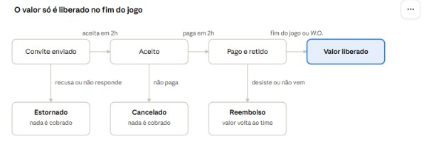

# Bora Jogar — Documentação do app por sessão

**30 de set. de 2026.** `@Someone`

## Visão geral

**Bora Jogar** é um app para Android e iOS que liga times, quadras, árbitros e jogadores de aluguel da mesma cidade, com reserva e pagamento dentro do app. Este documento descreve o protótipo publicado em **Bora Jogar protótipo**, sessão por sessão, para revisão das regras antes do desenvolvimento.

* **Modalidades:** só quadras de futsal e society.
* **Região:** cada cidade é uma região. A cidade piloto é São Mateus do Sul (PR); Irati e União da Vitória têm dados de exemplo.
* **Perfis:** time (capitão), dono de quadra, árbitro e jogador de aluguel. Uma mesma pessoa pode ter mais de um perfil.
* **Receita:** taxa de 5% sobre cada transação contratada (quadra, arbitragem e jogador cobrado). Cadastro gratuito para todos.
* **Navegação:** seis abas fixas no rodapé (Início, Quadras, Contratar, Ranking, Jogos, Perfil), sino de notificações no topo e botão de sugestão flutuante.

> **Status do protótipo:** Os pagamentos são simulados, e mapa e GPS são ilustrativos. Os testadores convidados com permissão de edição compartilham os mesmos dados; quem abre por link público usa o modo local.

---

## 1. Início

A tela inicial mostra o que está aberto para jogar na cidade escolhida, com duas visões alternadas no topo: **Sou um time** e **Sou jogador**.

### Topo da tela (vale para todas as sessões)
* Seletor de cidade, com busca. Trocar a cidade muda quadras, desafios, ranking, jogadores e árbitros exibidos.
* Sino de notificações com o número de não lidas (ver sessão 9).
* Faixa de modo: **Teste compartilhado** (dados visíveis a todos os testadores) ou **Modo local** (só no aparelho).
* Aviso para criar o próprio time, enquanto a pessoa ainda usa o time de exemplo.

### Visão Sou um time

| Bloco | O que mostra | Ações |
| :--- | :--- | :--- |
| **Desafios abertos** | Time, nota, nível, modalidade, data e hora, quadra, recado. Marca "horário já reservado" quando o criador já pagou a quadra. | Ver avaliações do time; Aceitar desafio (abre a reserva). No próprio desafio: Retirar. |
| **Criar desafio** | Formulário com quadra, dia, horário e recado. | Publicar. Só aparece se a cidade tiver quadra cadastrada. |
| **Rivais do seu nível** | Até 4 times da cidade com o mesmo nível, ordenados pela nota. | Abrir o perfil do time e desafiar. |

### Visão Sou jogador
* Lista de times da cidade pedindo jogador, com a posição, a data e a quadra. Botão **Quero jogar**.
* Atalho para se cadastrar como jogador de aluguel, se a pessoa ainda não tiver cadastro.

### Regras desta sessão
* Desafios vencidos (data passada) somem da lista.
* Quando alguém aceita um desafio, ele sai da lista para todos.
* Cidade sem quadra mostra o convite para cadastrar a primeira quadra no lugar de **Criar desafio**.

---

## 2. Quadras

Lista e mapa das quadras de futsal e society da cidade, com horários livres e reserva direta.

### Lista e mapa
* Filtro por tipo: **Todas**, **Futsal**, **Society**.
* Alternar entre **Lista** e **Mapa**. No mapa, cada pino tem a cor do tipo e abre a quadra ao ser tocado.
* Cada item da lista mostra nome, bairro, piso, nota, preço da hora e quantos horários livres restam hoje.
* No fim da lista fica o atalho **Tem uma quadra? Cadastre grátis**.

### Página da quadra

| Parte | Conteúdo |
| :--- | :--- |
| **Fotos** | Galeria com até 6 fotos; sem foto, aparece uma ilustração da quadra. |
| **Dados** | Nota e número de avaliações, endereço, bairro, cidade, horário de funcionamento, piso, WhatsApp, descrição e estrutura (vestiário, estacionamento etc.). |
| **Dias** | Próximos 7 dias. |
| **Horários** | Blocos de 1 hora, do horário de abertura ao de fechamento. Cada bloco aparece como **Livre**, **Ocupado** ou **Passou**. |
| **Reservar** | Botão que abre a reserva do horário escolhido (sessão 3). |

### Regras desta sessão
* Um horário fica ocupado assim que um jogo ativo é criado nele. Jogos cancelados liberam o horário.
* Horários de hoje que já passaram não podem ser reservados.
* No protótipo, o mapa é ilustrativo. No app real, será Google Maps ou Mapbox com a localização marcada no cadastro.

---

## 3. Reserva e pagamento

Na reserva, o time paga só a quadra. A arbitragem é cobrada depois, quando o árbitro aceita o convite.

### Passo a passo da reserva
1. Escolher o adversário (um time da cidade) ou deixar como desafio aberto.
2. Escolher a duração (1h, 1h30 ou 2h; o preço acompanha) e ligar ou desligar a divisão 50/50. Com desafio aceito, a divisão fica sempre ligada.
3. Escolher 0, 1 ou 2 árbitros. Só aparece se faltar mais de 1h para o jogo.
4. Conferir o resumo: quadra, taxa do app de 5% e o valor a pagar agora.
5. Pagar com Pix ou cartão de crédito.

### Tela de pagamento (usada em todas as cobranças)
* Mostra o que está sendo pago, as linhas do valor e o total, já com a tarifa do meio de pagamento, que é repassada ao usuário e não sai dos 5% do app.
* **Pix:** QR Code e código copia e cola.
* **Cartão de crédito:** número, nome impresso, validade e CVV. O sistema confere o formato antes de aprovar. Parcelamento em até 6x, com o acréscimo cobrado pela operadora do cartão.
* No protótipo, os dois são simulados e o cartão vem preenchido com dados fictícios.

### Exemplo de valores (quadra de R$ 100, um árbitro de R$ 30, divisão 50/50)

| Cobrança | Quando | Cada time paga |
| :--- | :--- | :--- |
| **Quadra** | Na reserva (quem aceita o desafio paga ao aceitar) | R$ 50,00 + R$ 2,50 de taxa = **R$ 52,50** |
| **Arbitragem** | Até 2h depois do aceite do árbitro | R$ 15,00 + R$ 0,75 de taxa + R$ 15,00 de caução = **R$ 30,75** |

### Regras desta sessão
* O horário trava quando o primeiro time paga a quadra.
* O time convidado confirma o jogo pagando a sua parte (ou tocando em **Confirmar**, se não houver 50/50). Se recusar, o jogo vira desafio aberto. Depois de confirmar, valem as regras de cancelamento e W.O.
* A caução da arbitragem (metade do valor do outro time) volta no fim do jogo, se os dois comparecerem.
* Se um time não pagar a parte da arbitragem em 2h, quem contratou pode pagar por ele ou cancelar o árbitro.
* Os pagamentos são divididos pelo gateway (split): quadra, árbitro, jogador e app recebem cada um a sua parte.

---

## 4. Contratar (jogadores de aluguel e arbitragem)

Jogador e árbitro seguem o mesmo fluxo: convite, aceite em até 2h, pagamento em até 2h e valor retido até o fim do jogo.

Cada etapa tem um prazo; perder qualquer um desfaz a contratação sem cobrar o que não foi pago.

### Listas
* Duas abas: **Jogadores de aluguel** e **Arbitragem**. Filtro por modalidade (futsal, society); nos jogadores, também por posição (goleiro ou linha).
* Cada cartão mostra nome, nível, bairro, número de jogos, nota, posições ou funções, as 3 principais habilidades, o preço (ou Passe livre) e os W.O.
* O perfil mostra habilidades ou características com a contagem de times que confirmaram cada uma, além de histórico de W.O. e avaliações.

### Contratar
1. Escolher o jogo, entre os jogos do próprio time que faltam mais de 1h30.
2. Escolher a posição (jogador) ou a função (árbitro), entre as que ele cadastrou.
3. Ver o valor que será cobrado depois do aceite e enviar o convite. Nada é cobrado nesta etapa.

| Etapa | Prazo | Regra / Se passar do prazo |
| :--- | :--- | :--- |
| **Contratar** | Até 1h30 antes do jogo | Botões de contratação somem. |
| **Aceitar** | 2h após o convite | Aceite e pagamento terminam no máximo 1h antes do jogo; se faltar pouco, o tempo até esse limite é dividido ao meio. A notificação mostra o horário limite. Se passar: convite estornado; os dois lados são notificados. |
| **Pagar** | 2h após o aceite | No Pix ou cartão, terminando no máximo 1h antes do jogo. Se passar: contratação cancelada; os dois lados são notificados. |
| **Desistir** | Até 2h antes do jogo, depois de aceitar | Depois disso, não comparecer vira W.O. |

### Valores
* **Jogador:** quem contrata paga o valor dele mais 5%. Se for passe livre, o aceite já confirma, sem pagamento.
* **Árbitro:** até 2 por jogo. Com 50/50, cada time paga a sua metade mais 5% e deixa uma caução no valor da metade do outro. O adversário é notificado para pagar a parte dele no mesmo prazo de 2h.
* Se o adversário não pagar a parte da arbitragem, quem contratou escolhe entre pagar por ele ou cancelar o árbitro.
* O pagamento fica retido e é liberado automaticamente no fim do horário reservado ou quando o W.O. é registrado.

---

## 5. Jogos

Cada jogo tem um cartão com o que foi pago, o que falta e quem está confirmado. O jogo termina sozinho no fim do horário reservado (1h, 1h30 ou 2h), e é aí que os repasses são feitos.

### Próximos jogos (cartão ativo)
* Placar com os dois times e contagem regressiva.
* Situação da quadra: *"Quadra paga no Pix/cartão"* ou *"Falta você pagar"* (com botão). O mesmo aparece para o adversário.
* Uma linha por contratação: convite aguardando, aceito com botão de pagar, pago e retido, ou o motivo de ter saído (recusou, expirou, cancelado, desistiu, W.O.).
* Caução retida e prazo de desistência de árbitro e jogadores.
* Atalhos **+ Jogador** e **+ Árbitro** enquanto faltar mais de 1h.
* Cancelar reserva enquanto faltar mais de 2h. Depois disso, fica bloqueado.

### Confirmação do jogo
* O time convidado vê o aviso *"marcou este jogo com vocês"* com os botões **Confirmar e pagar (50/50)** ou **Confirmar jogo (sem 50/50)** e **Recusar**.
* Recusar transforma o jogo em desafio aberto para outros times. O convidado tem o mesmo prazo dos convites (até 2h, terminando 1h antes do jogo); sem resposta, o convite é estornado e o jogo também vira desafio aberto. Depois de confirmar, valem as regras de cancelamento e W.O.

### Check-in no local

| Item | Regra |
| :--- | :--- |
| **Quem faz** | Capitão de cada time, cada árbitro e cada jogador contratado |
| **Como** | Pelo celular, confirmando a localização na quadra. Sem sinal ou sem GPS, só a quadra pode confirmar a chegada |
| **Abre** | 1h antes do início |
| **Fecha** | 15 min depois do início |
| **Quem não fizer** | Leva W.O. automaticamente |

O cartão do jogo mostra quem já fez check-in. O árbitro e o jogador fazem o check-in pelo painel deles no Perfil.

### Anteriores

| Situação | O que o cartão mostra |
| :--- | :--- |
| **Encerrado** | Placar informado pelo dono da quadra, pagamentos liberados a árbitros e jogadores, caução devolvida, botão para avaliar o adversário. |
| **W.O. (o outro faltou)** | Tabela do acerto: quanto volta para você, quanto fica para a quadra, para o árbitro e para o app, e quanto volta para o time faltoso. |
| **W.O. (seu time faltou)** | Aviso de W.O. no histórico e quanto volta para vocês. |
| **Cancelado** | Quem cancelou, quanto voltou e quanto ficou retido. |

### Cancelamento (até 2h antes)
* Quem cancela recebe de volta a parte da quadra menos 10% (fica para a quadra), mais o que pagou a árbitro e jogadores e a caução. A taxa de 5% do app não volta, e quem cancela também arca com a taxa de 5% do outro time. O aviso de reembolso deixa claro o prazo: no Pix volta na hora; no cartão pode levar até 2 faturas. A tarifa do meio de pagamento não é devolvida.
* O outro time recebe 100% de volta, incluindo a taxa.
* Contratados são notificados e a contratação é desfeita.

### W.O.
* **Quem faltou** arca com os custos: 30% do valor da quadra e a arbitragem inteira, além do jogador que contratou. O que sobra do que pagou volta para ele.
* **Time presente:** recebe de volta o que pagou, menos 30% da sua metade da quadra. Paga normalmente o jogador que contratou.
* **Quadra:** fica com 30% do valor da quadra.
* Se o faltoso não pagou o suficiente (por exemplo, jogo sem 50/50): fica com pendência e bloqueado para marcar jogos, aceitar desafios e contratar até quitar. Quadra e árbitro recebem aviso do valor pendente e outro quando ele for pago.
* **Os dois faltaram:** cada um arca com metade dos custos.
* **Nota:** quem falta recebe o equivalente a 10 avaliações de 1 estrela em pontualidade e comprometimento, e o W.O. fica no histórico.
* **Árbitro ou jogador que não faz check-in:** leva W.O. no perfil, e o valor dele volta para quem pagou. Jogador (cobrado ou de passe livre) e árbitro levam cartão vermelho: 7 dias sem poder ser convocados.

> No protótipo há botões **"Simular"** para testar cada caminho sem esperar os prazos reais.

---

## 6. Ranking e avaliações

O ranking é feito só com as notas que os adversários dão depois de cada jogo, como no Uber: os dois lados se avaliam.

### Ranking
* Times da cidade, filtrados por nível (iniciante, intermediário, avançado) e pela chave **Só rivais do meu nível**.
* Ordenação por nota geral, jogo limpo ou pontualidade. Times sem jogo avaliado aparecem no fim, marcados como **Novo**.
* Selos automáticos: **Pontual**, **Jogo limpo** e **Comprometido** (nota a partir de 4,6 ou 4,7), **Jogo pegado** (jogo limpo abaixo de 4) e contagem de W.O. em vermelho.

### Avaliação depois do jogo

| Critério | Pergunta na tela |
| :--- | :--- |
| **Pontualidade** | Chegaram no horário? |
| **Jogo limpo** | Jogo limpo, sem briga? |
| **Comprometimento** | Cumpriram o combinado? |
| **Organização** | Time organizado? |

* Nota de 1 a 5 estrelas em cada critério (os 4 são obrigatórios), destaques opcionais e comentário opcional.
* A nota de cada time só aparece para o outro quando os dois avaliarem, para evitar retaliação.
* A nota do time é a média de todas as avaliações recebidas; a nota geral é a média dos 4 critérios.
* O W.O. pesa como 10 avaliações de 1 estrela em pontualidade e comprometimento. Um time com nota 4,8 e 51 jogos cai para cerca de 4,5 com um W.O.

### Comunidade: moderação e denúncia
* Comentários de avaliação, nomes, descrições, recados de desafio e habilidades passam por revisão automática antes de publicar.
* Por enquanto, a revisão é um filtro de palavras que bloqueia palavrões e termos racistas. A revisão por IA ficou desligada para evitar custo e pode ser ligada depois.
* Texto bloqueado não é publicado; a pessoa vê o motivo e pode reescrever.
* Todo perfil (time, jogador, árbitro) tem o botão **Denunciar perfil**, com motivo (ofensa, racismo ou preconceito, violência em jogo, não pagou, perfil falso, outro) e relato opcional. Só a equipe do app vê as denúncias.

---

## 7. Perfil e painéis

O Perfil tem quatro painéis, um por papel. Quem ainda não tem cadastro naquele papel vê um painel de exemplo e o botão para se cadastrar.

| Painel | O que mostra | Ações |
| :--- | :--- | :--- |
| **Meu time** | Escudo, nível, cidade, nota por critério, selos, histórico de W.O., jogos, W.O. e jogos marcados. | Criar meu time. |
| **Quadra** | Endereço, fotos, reservas, valor a receber (reservas, parte do W.O. e taxa de cancelamento), agenda com status e exemplo de repartição de uma reserva. | Ver página da quadra; informar o placar dos jogos encerrados; confirmar a chegada de quem está sem sinal no check-in; cadastrar ou alterar o recebimento. |
| **Árbitro** | Perfil, convites novos, a receber, recebido e lista de convites e jogos. | Aceitar, recusar, desistir (até 2h antes), fazer check-in; cadastrar ou alterar o recebimento. |
| **Jogador** | Igual ao do árbitro, com a posição pedida em cada convite. | Aceitar, recusar, desistir (até 2h antes), fazer check-in; cadastrar ou alterar o recebimento. |

### Situação de cada convite (árbitro e jogador)
* **Novo:** mostra o prazo para responder e os botões *Aceitar* e *Recusar*.
* **Aguardando pagamento:** mostra até quando o time tem para pagar.
* **Confirmado e pago:** o valor fica retido e cai na conta no fim do jogo. Na janela do check-in aparece o botão *Fazer check-in*.
* **Recebido:** depois do fim do jogo ou do W.O. do time.
* **Encerrados:** recusado, expirado, cancelado, desistiu, W.O.

### Também no Perfil
* Tabela das taxas do app e o resumo de todas as regras.
* Para o dono do app: Lista das sugestões enviadas pelos testadores e das denúncias de perfis.

---

## 8. Cadastros

Todo cadastro que recebe dinheiro (quadra, árbitro e jogador) exige os dados de recebimento antes de publicar.

| Cadastro | Campos | Obrigatórios |
| :--- | :--- | :--- |
| **Time** | Nome, cidade, nível, cor do escudo (a sigla sai do nome). | Nome |
| **Quadra** | Nome do estabelecimento, tipo (futsal ou society), piso, descrição, cidade, endereço, bairro, ponto no mapa, até 6 fotos, valor da hora, abertura e fechamento, estrutura, WhatsApp, recebimento. | Nome, endereço, bairro, ponto no mapa, valor, horário válido, recebimento |
| **Jogador de aluguel** | Nome, cidade, bairro, modalidades, posições (várias), nível, habilidades (lista + outras escritas à mão), passe livre ou valor por jogo, sobre você, recebimento. | Nome, modalidade, ao menos uma posição, valor (se cobrar), recebimento |
| **Árbitro** | Nome, cidade, bairro, modalidades, funções (principal, segundo árbitro, anotador), características (lista + outras), anos de experiência, valor por jogo, curso ou certificação, recebimento. | Nome, modalidade, ao menos uma função, valor, recebimento |

### Dados de recebimento

| Opção | Campos |
| :--- | :--- |
| **Pix** | Tipo de chave (CPF, CNPJ, celular, e-mail, aleatória) e chave |
| **Conta bancária** | Banco, agência, conta com dígito, tipo (corrente ou poupança), nome do titular, CPF ou CNPJ do titular |

* Os dados completos ficam numa área privada, que só o dono do cadastro lê. Os outros usuários veem apenas um resumo mascarado (ex.: *"Banco do Brasil ag. 1234. conta ...89-0"*).
* Os dados podem ser alterados no Perfil, em **Recebimento > Alterar**.
* No app real, esses dados vão para o gateway de pagamento, que confere a titularidade antes do primeiro repasse.
* Fotos são reduzidas no próprio aparelho antes do envio. A localização é marcada tocando no mapa ou pelo GPS. Nomes, descrições e habilidades passam pela revisão automática antes de publicar.

---

## 9. Notificações

O sino no topo mostra as não lidas; ao abrir, todas são marcadas como lidas e cada uma leva à tela do assunto. No app real, as mesmas mensagens saem como notificação push.

| Evento | Quem recebe | Leva para |
| :--- | :--- | :--- |
| Convite para jogar ou apitar (com valor e horário limite para responder) | Jogador ou árbitro | Perfil > Jogador / Árbitro |
| Convite aceito (com valor e horário limite para pagar) | Time contratante | Jogos |
| Árbitro confirmado: pagar a parte da arbitragem | Time adversário | Jogos |
| Convite recusado | Time contratante | Jogos |
| Convite expirou sem resposta | Time contratante e contratado | Jogos / Perfil |
| Pagamento confirmado: valor sai no fim do jogo | Jogador ou árbitro | Perfil |
| Prazo de pagamento acabou: contratação cancelada | Contratado e time contratante | Perfil / Jogos |
| Contratado desistiu: valor volta (com prazo de estorno) | Time contratante (e adversário, se for árbitro) | Jogos |
| Jogo marcado contra você: confirme ou recuse | Time convidado | Jogos |
| Jogo confirmado / recusado | Time que marcou | Jogos |
| Desafio aceito | Criador do desafio | Jogos |
| Adversário pagou a parte da quadra | O outro time | Jogos |
| Jogo cancelado: reembolso e prazo de estorno | O outro time e os contratados | Jogos / Perfil |
| W.O. por falta de check-in | Time faltoso, contratado faltoso, quadra, time presente | Jogos / Perfil |
| Pendência do W.O.: pague para voltar a jogar | Time faltoso | Jogos |
| Valor pendente: o time faltoso ainda não pagou | Quadra e árbitro | Perfil |
| Pendência quitada: valor liberado | Quadra e árbitro | Jogos |
| Cartão vermelho: 7 dias sem convocações | Jogador ou árbitro que deu W.O. | Jogos |
| Jogo encerrado: avalie o adversário | Os dois times | Jogos / Perfil |
| Pagamento liberado / repasse da quadra (com pedido de placar) | Jogador, árbitro e quadra | Perfil |
| Placar informado pela quadra | Os dois times | Perfil |
| Seu time foi avaliado | Time avaliado | Jogos |
| Convite de jogo expirou (time convidado não confirmou no prazo) | Time convidado e time que marcou | Perfil |
| Chegada confirmada pela quadra (sem sinal ou GPS) | Time, jogador ou árbitro confirmado | Jogos |

> No protótipo, o controle dos prazos roda no aparelho do time que criou o jogo, a cada 15 segundos. No app real, isso vira uma rotina no servidor, que roda mesmo com todos os celulares fechados.

---

## 10. Regras financeiras e prazos

O app fica com 5% de tudo o que é contratado. Quem presta o serviço recebe sempre o preço cheio que cadastrou.

### Taxas e retenções

| Item | Valor | Fica com |
| :--- | :--- | :--- |
| **Taxa de serviço** | 5% sobre quadra, arbitragem e jogador cobrado | App (não volta em cancelamento nem em W.O.) |
| **Jogador de passe livre** | Sem taxa | — |
| **Tarifa do meio de pagamento** | Pix ou cartão, conforme o gateway | Repassada a quem paga; fora dos 5% do app e não devolvida em reembolsos |
| **Parcelamento no cartão** | Até 6x, com o acréscimo da operadora | Repassado a quem paga |
| **Taxa administrativa de cancelamento** | 10% da parte da quadra de quem cancelou | Quadra |
| **Taxa do app do time inocente, no cancelamento** | 5% do que ele pagou | Descontada de quem cancelou |
| **Caução da arbitragem** | Metade do valor do outro time, por time | Retida; volta no fim do jogo |
| **W.O.: custos do faltoso** | 30% do valor da quadra (menos a parte do presente) e a arbitragem inteira | Quadra e árbitro |
| **W.O.: parte do time presente** | 30% da sua metade da quadra | Quadra |

### Exemplos de W.O.
* **Com 50/50** (quadra R$ 100, árbitro R$ 30, time presente com goleiro de R$ 30): o presente recebe R$ 65 de volta, a quadra fica com R$ 30, o árbitro recebe R$ 30, o goleiro recebe R$ 30 e o faltoso recebe R$ 35 de volta.
* **Sem 50/50** (2h a R$ 140/h, o time que marcou pagou R$ 280 e o convidado faltou): quem marcou recebe R$ 238 de volta, a quadra recebe R$ 42 na hora e mais R$ 42 quando o faltoso quitar, e o faltoso fica bloqueado com R$ 42 em aberto.

### Prazos

| Prazo | Conta a partir de | Tempo |
| :--- | :--- | :--- |
| **Convidar um time específico ou contratar jogador e árbitro** | Início do jogo | Até 1h30 antes |
| **Time convidado confirmar (pagando a sua parte)** | Convite | 2h, terminando no máximo 1h antes; sem resposta, vira desafio aberto |
| **Aceitar convite (jogador ou árbitro)** | Envio do convite | 2h, terminando no máximo 1h antes; perto do jogo, metade do tempo até o limite |
| **Pagar contratado** | Aceite do convite | 2h, terminando no máximo 1h antes |
| **Cancelar a reserva** | Início do jogo | Até 2h antes |
| **Jogador ou árbitro desistir depois de aceitar** | Início do jogo | Até 2h antes |
| **Check-in** | Início do jogo | Abre 1h antes e fecha 15 min depois; sem sinal, a quadra confirma |
| **Fim automático e repasses** | Início do jogo | No fim do horário reservado (1h, 1h30 ou 2h) |
| **Cartão vermelho (jogador ou árbitro com W.O.)** | W.O. | 7 dias sem convocações |

### Pagamento e recebimento
* Todas as cobranças aceitam Pix ou cartão de crédito (com parcelamento).
* Quadra, árbitro e jogador recebem por Pix ou conta bancária.
* O gateway faz o split: cada parte vai direto para quem tem direito, sem passar pela conta da empresa.
* Todo aviso de reembolso diz o prazo: no Pix volta na hora; no cartão pode levar até 2 faturas. A tarifa do meio de pagamento não é devolvida.

---

## 11. Decisões e pontos em aberto

As perguntas das duas rodadas de revisão foram decididas em 30/09/2026 e já estão aplicadas no protótipo e nas sessões acima.

| Tema | Decisão |
| :--- | :--- |
| **Prazos perto do jogo** | Tudo termina 1h antes do jogo: aceite, pagamento e confirmação. Contratar só até 1h30 antes. A notificação mostra o horário limite |
| **Desistência de jogador e árbitro** | Até 2h antes, o mesmo limite do cancelamento da quadra |
| **Confirmação do time convidado** | Confirmar é pagar a sua parte, com a mesma regra de prazo dos convites; sem resposta, o convite é estornado |
| **Duração da reserva** | 1h, 1h30 ou 2h |
| **Quem confirma o W.O.** | Check-in por localização; abre 1h antes, fecha 15 min depois. Sem sinal ou GPS, só a quadra confirma a chegada |
| **Placar** | Informado pelo dono da quadra |
| **W.O. sem 50/50** | O faltoso paga todos os custos |
| **Os dois times sem check-in** | Cada um arca com metade dos custos |
| **Saldo devedor** | Time bloqueado até quitar; quadra e árbitro avisados do que está pendente |
| **Taxa do time inocente no cancelamento** | Quem cancelou arca |
| **Tarifas do gateway** | Repassadas a quem paga e não devolvidas em reembolsos; os avisos deixam isso claro |
| **Parcelamento no cartão** | Sim, com o acréscimo da operadora |
| **Prazo de estorno no cartão** | Aviso claro em todo reembolso |
| **Moderação** | Filtro de palavras e denúncia de perfis. Revisão por IA desligada por enquanto |
| **W.O. de jogador ou árbitro** | Cartão vermelho para todos: 7 dias sem convocações |

*Não há pontos em aberto no momento. Novas dúvidas que surgirem nos testes entram aqui.*